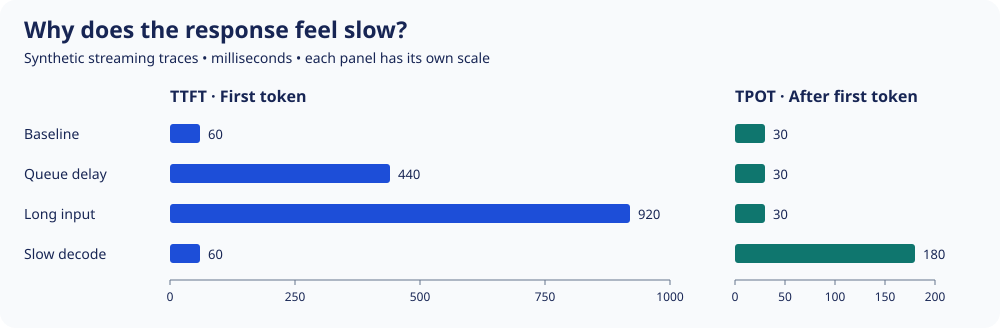

# Why is the first token slow?

A technical-support case study for **streaming LLM latency**. A customer says the response feels slow. The first question is: **Does it take too long to start, or does it start quickly and then trickle out?**

This repo replays four synthetic requests on a laptop. It does not call an LLM, require credentials or a GPU, or report production benchmark results.



## Reproduce the case

Run with Python 3.8+ from the repository root. No packages to install.

```sh
python3 demo.py baseline
python3 demo.py queue --realtime
python3 demo.py long-input
python3 demo.py decode
python3 -m unittest -v
```

`demo.py` issues a request to an in-process simulator and prints one newline-delimited JSON event at a time: request, prefill start/end, token events, done, and a calculated summary. It uses a virtual clock by default. The optional `--realtime` mode paces stdout so you can experience the delay; reported timestamps still come from the simulator. No HTTP endpoint or tokenizer is involved.

The fixture logs in [examples/](examples/) are deterministic and entirely synthetic. For example, the queued request emits its first token at 440 ms:

```jsonl
{"event":"request","scenario":"queue","t_ms":0,"input_tokens":128,"synthetic":true}
{"event":"prefill_start","t_ms":400}
{"event":"prefill_end","t_ms":440}
{"event":"token","t_ms":440,"index":1}
{"event":"token","t_ms":470,"index":2}
```

## Read the signal

- **TTFT (time to first token):** first output token observed minus request start. For a real endpoint, measure client-side from send to the first nonempty generated content, not the first HTTP byte, role-only chunk, or heartbeat.
- **TPOT (time per output token):** (last token time − first token time) ÷ (output token count − 1). A one-token response has no TPOT. This average can hide stalls, so also inspect inter-token gaps when per-token timestamps are available. A stream chunk is not necessarily one model token.

| Synthetic case | Input tokens | Queue | Prefill | TTFT | TPOT | First check |
|---|---:|---:|---:|---:|---:|---|
| Baseline | 128 | 20 ms | 40 ms | 60 ms | 30 ms | Establish a controlled reference |
| Queue delay | 128 | 400 ms | 40 ms | 440 ms | 30 ms | Check admission wait and backlog |
| Long input | 4,096 | 20 ms | 900 ms | 920 ms | 30 ms | Compare measured prefill across prompt lengths |
| Slow decode | 128 | 20 ms | 40 ms | 60 ms | 180 ms | Inspect time between emitted tokens |

TTFT equals queue plus prefill **only in this simulator**. In production it may also include network and proxy time, tokenization, scheduler behavior, first-token processing, and buffering. TTFT and TPOT point to what to investigate; they do not prove the root cause.

## How I would troubleshoot a real endpoint

1. **Reproduce from the client.** Capture request ID, model/version, region, concurrency, prompt length in tokens, and first/last content timestamps. Hold model, streaming mode, cache state, input shape, and output target constant except for the variable under test. Do not collect raw prompts or patient data.
2. **Separate queueing from long-input work.** For queueing, step down concurrency without changing the input. Verify that TTFT and scheduler queue time fall together and prefill is stable. For prefill, compare short and long prompts at low concurrency with similar cache conditions. Check whether prefill rises while queue time and decode stay comparable.
3. **Isolate decode.** If TTFT is normal but TPOT is high, compare an isolated request with the same request at representative concurrency. Correlate per-token gaps and server decode metrics with active batch size, GPU utilization, and KV-cache pressure; check for proxy buffering if server and client timing diverge. Change one factor at a time rather than assuming a GPU bottleneck.
4. **Verify the change.** Repeat the same workload and compare p50/p95 TTFT and TPOT, throughput, and error rate. Report request counts, workload, and measurement boundaries. Confirm latency improved without trading away an agreed throughput or reliability target.

For implementation-specific metric names, see the [vLLM metrics guide](https://docs.vllm.ai/en/latest/design/metrics/) and [vLLM benchmarking CLI docs](https://docs.vllm.ai/en/stable/benchmarking/cli/).
